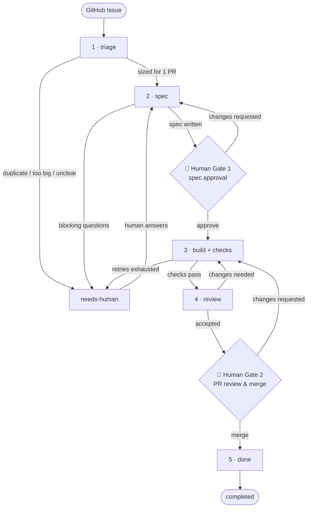

# acp-factory

An automated multi-stage software engineering runner built on the **Agent Client Protocol (ACP)** via [`acpterm`](/home/stephanie/DEV/acpterm) and **APM (Agent Package Manager)**.

Inspired by `owainlewis/factory` and `owainlewis/software-factory`, `acp-factory` runs ACP-compliant coding agents (`opencode`, `kiro`, `copilot`, `agy`, etc.) across a **5-stage GitHub label workflow** with per-stage personas, `apm` skills, deterministic verification checks, and two mandatory human gates:



📖 **New to the team? Check out the [Team Onboarding Guide](docs/team-onboarding.md) to get set up in 5 minutes.**  
📖 **See [docs/workflow.md](docs/workflow.md) for the complete architecture, GitHub label state machine, and core concepts.**

---

## Key Capabilities

- **Powered by `acpterm`**: Reuses `acpterm`'s `ACPAgent` connection engine, `~/.acpterm/config.json` agent registry, auth token resolution, permission hooks, Rich streaming output, and Markdown transcript recording.
- **Per-Stage Agent, Persona & `apm` Skill Customization**: Each stage (`triage`, `spec`, `build`, `review`) configures its own `agent`, `model`, `mode` (`plan` vs `code`), `read_only` enforcement, role `persona` (`.md`), and `skills` (`SKILL.md` installed via `apm` or `.factory/skills/`).
- **Clean GitHub Integration (Zero Bot Comment Spam)**:
  - The **Issue Body** (`<!-- factory:start -->` block) is updated in-place as the single source of truth for the specification, assumptions, decisions, and any open questions.
  - **Issue Comments** are reserved strictly for humans (answering open questions or providing feedback).
  - **Two Mandatory Human Gates** (`factory:spec-ready` and `factory:pr-ready`) and **no automatic PR merging**.
- **Sequential Fail-Fast Checks & Self-Healing Loop**: Keeps the ACP session alive across retry turns with intelligent output truncation.

---

## Installation

```bash
uv sync
```

Or install globally as a CLI tool:

```bash
uv tool install -e .
```

---

## Configuration Precedence

`acp-factory` resolves configuration from the highest-precedence source available (explicit `--config` > repo-local > user-level > built-in defaults), in this order:

1. **Explicit `--config` CLI argument** (`-c`) — the highest precedence.
2. **Repo-local config** — `.factory/config.toml`, `.factory/config.yaml`, `.factory/config.yml`, `factory.toml`, `factory.yaml`, or `factory.yml` in the workspace.
3. **User-level config** — `~/.acp-factory/config.toml`, then `~/.config/acp-factory/config.toml` (the first existing file wins).
4. **Built-in defaults** — `FactoryConfig()`.

Persona, prompt, and skill paths in a config file resolve relative to that config file's directory, so a user-level config can reference shared assets without copying them into every repository. Fleet runs intentionally skip the user-level fallback so bare target repos never inherit the operator's personal `pre`/`checks` settings.

Example `~/.acp-factory/config.toml`:

```toml
version = "1"

[agent]
name = "opencode"
persona = "personas/architect.md"

task = "personal-default-task"
```

Place personas and skills alongside the config file (e.g. `~/.acp-factory/personas/architect.md`, `~/.acp-factory/skills/<skill>/SKILL.md`).

---

## Quick Start

### 1. Scaffold a Multi-Stage `.factory/` Workspace

```bash
acp-factory init --multi-stage
```

This creates:
- `.factory/config.toml` — Stage definitions (`triage`, `spec`, `build`, `review`) and reusable checks (`lint`, `test`, `review`)
- `.factory/personas/{triage,architect,implementer,reviewer}.md` — Role personas per stage
- `.factory/prompts/{TRIAGE,SPEC,BUILD,REVIEW}.md` — Stage prompt contracts
- `apm.yml` — Agent Package Manager manifest for skills and MCP dependencies

*(For a simple single-file config, run `acp-factory init` to generate `factory.yaml`.)*

### 2. Run a GitHub Issue Workflow (or Dry-Run)

Check the queue of open `factory:*` issues and local `.worktrees/`:

```bash
acp-factory status
```

Run the current stage for a specific GitHub issue (add `--dry-run` to preview the proposed Issue/PR bodies locally and get copy-pasteable `gh` commands without mutating GitHub):

```bash
acp-factory issue 1 --dry-run
acp-factory issue 1
```

Or automatically process the next actionable issue in the repository queue:

```bash
acp-factory next
```

### Fleet Orchestration (Multi-Repo)

Run the same 5-stage workflow across many repositories. Each `owner/repo` maps to an explicit local checkout path (no on-demand cloning).

Fleet registries are operator-specific and should **not** be committed to project repositories. Keep them in an operator-level file instead:

1. `~/.acp-factory/fleet.toml` (primary)
2. `~/.config/acp-factory/fleet.toml` (XDG fallback, used when the primary is absent)

```toml
# ~/.acp-factory/fleet.toml
max_active_branches_per_repo = 1   # default
max_review_rounds = 3              # optional; overrides top-level

[repositories]
"acme/core-lib" = "~/DEV/core-lib"    # existing local checkout
"acme/service-api" = "~/DEV/service-api"
```

The `[fleet]` table wrapper is optional: both `[repositories]` at the root and `[fleet.repositories]` are accepted. When the active config (e.g. a repo-local `.factory/config.toml`) has no `[fleet]` section, `--fleet` automatically overlays the operator-level file. A repo-local `[fleet]` section is preserved; pass `--fleet-config <path>` to override it explicitly:

```toml
# Any project's .factory/config.toml (still supported)
[fleet]
max_active_branches_per_repo = 1

[fleet.repositories]
"acme/core-lib" = "~/DEV/core-lib"
"acme/service-api" = "~/DEV/service-api"
```

Advance one step per repo (with stage-aware admission control so each repo has at most one in-flight `build`/`review`/`pr-ready` branch) and inspect per-repo status:

```bash
acp-factory next --fleet
acp-factory status --fleet
acp-factory next --fleet-config /path/to/custom-fleet.toml
```

`--fleet` is auto-enabled whenever a `[fleet]` section is present in the active config, or when `--fleet-config` is supplied (unless `--no-fleet` is also given). `--fleet-config <path>` must point to an existing TOML file.

#### How to Test Fleet Mode

1. **Configure local checkouts** in `~/.acp-factory/fleet.toml` (or pass a custom file with `--fleet-config`):
   ```toml
   [repositories]
   "owner/repo-a" = "~/DEV/repo-a"
   "owner/repo-b" = "~/DEV/repo-b"
   ```

2. **Inspect multi-repo status** across all configured repositories:
   ```bash
   acp-factory status --fleet
   ```
   *Expected*: A consolidated table listing each repository, its open `factory:*` issues, human gates, and local worktrees without mutating git or GitHub state.

3. **Dry-run a single fleet pass** (safe verification without GitHub writes):
   ```bash
   acp-factory next --fleet -n 1 --dry-run
   ```
   *Expected*: The orchestrator selects the next actionable issue, runs its stage in dry-run mode, logs the active repository/issue/stage in the terminal header, saves proposed run artifacts under `.factory/runs/<run-id>/`, and prints manual `gh` commands without mutating GitHub.

### 3. Review a Standalone Working Branch (With Optional PR Creation)

Review any checked-out branch in a target repository (even without a GitHub Issue or `.factory/` setup) using the bundled `code-reviewer` and `security-auditor` skills:

```bash
acp-factory review "Short description of what this branch changes" \
  --workspace /path/to/repo \
  --create-pr \
  --dry-run
```

### 4. Run an Ad-Hoc Stage or Task Locally

Run the `build` stage with its configured persona, skills, and checks:

```bash
acp-factory run "Implement pagination for GET /items" --stage build
```

Override agent, persona, or attach a skill on the CLI:

```bash
acp-factory run "Review the pagination implementation" \
  --stage review \
  --agent opencode \
  --persona .factory/personas/reviewer.md \
  --skill code-reviewer \
  --read-only
```

Export a full Markdown transcript of all attempts:

```bash
acp-factory run "Fix edge case in parser" --stage build --export transcript.md
```

---

## Execution Budget Guardrails

`acp-factory` can cap cumulative token usage, financial cost, and agent turns to protect against runaway tool loops, prompt inflation, and unexpected LLM API spend. Configure limits via the `[budget]` section (TOML or YAML):

```toml
[budget]
max_tokens_per_run = 100000   # cumulative token cap across all turns (optional, disabled when omitted)
max_cost_usd = 2.00           # cumulative cost cap in USD (optional, disabled when omitted; 0.0 allows zero spend)
max_turns = 10                # maximum agent turns per run (optional, disabled when omitted)
```

Each cap is optional and disabled when omitted. Note that in GitHub issue lifecycle mode (`issue` / `next`), `tokens`, `cost`, and `turns` counters accumulate across stages in the issue factory meta comment for telemetry and auditing, while `max_turns` is evaluated as a per-run execution budget cap. When a cap is breached mid-run, execution halts deterministically, the run is marked failed, and (in issue workflow mode) the issue is escalated to `factory:needs-human` with a `## Budget Escalation` banner. Cumulative tokens, cost, and turns are recorded in `.factory/runs/<run-id>/run.json` under `"usage"` and `"budget"`.

The same limits can be overridden per invocation with CLI flags on `acp-factory` (global) or on subcommands (`run`, `issue`, `next`):

```bash
acp-factory run --task "Run test task" --max-tokens 50000 --max-cost 1.50 --max-turns 2
acp-factory issue 42 --max-turns 5
```

---

## Documentation & Roadmap

- **[Workflow & Core Concepts (`docs/workflow.md`)](docs/workflow.md)**: Detailed guide to the 5-stage GitHub label state machine, Task definition, in-place Issue Body spec contract, two-tier open questions handling, and worktree lifecycle.
- **[Model Selection & Reasoning Strategy (`docs/model-selection.md`)](docs/model-selection.md)**: Guide to choosing models across stages, cognitive postures, turn timeout prevention on builds, and cross-model skeptical verification.
- **[Tracking & Daily Routine Guide (`docs/github-project-setup.md`)](docs/github-project-setup.md)**: Operator cheat sheet, daily morning routine, worktree management, and GitHub search bookmark filters.
- **[Stateless Fleet Orchestration & Review Hardening (`docs/fleet-orchestration.md`)](docs/fleet-orchestration.md)**: Architecture and invariants for multi-repo admission control, delta-focused review rounds, 3-round circuit breakers, and `REVIEWED_AT == HEAD` publish guards.
- **[Unattended Scheduling (`docs/scheduling.md`)](docs/scheduling.md)**: Running `acp-factory next` on a cron or systemd timer, with environment requirements, overlap protection, and ready-to-use recipes.
- **[Implementation Roadmap (`TODO.md`)](TODO.md)**: Current status and upcoming milestones.
