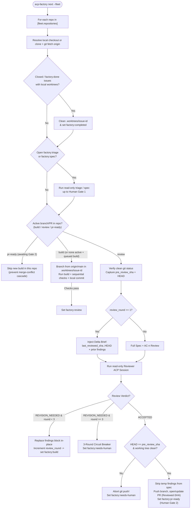

# Stateless Fleet Orchestration & Review Loop Hardening

This document specifies the design for scaling `acp-factory` across multiple repositories (or a GitHub organization) and hardening the `build <-> review -> publish` loop.

The design adapts battle-tested patterns from [`owainlewis/software-factory`](https://github.com/owainlewis/software-factory) (single-ticket review invariants) and [`owainlewis/machinist`](https://github.com/owainlewis/machinist) (multi-repo admission control), while keeping `acp-factory` **lightweight and 100% stateless on disk**—requiring no background daemon, SQLite database, or web server.

---

## 1. Architectural Philosophy: GitHub & Git as the Only State

Instead of maintaining a local database that can drift out of sync with GitHub, `acp-factory` derives all orchestration state directly from GitHub and Git on every invocation:

| State Dimension | Canonical Storage | Lifecycle |
| :--- | :--- | :--- |
| **Workflow Stage & Gates** | GitHub Issue `factory:*` labels | Replaced atomically by the orchestrator or human at Gates 1 & 2 |
| **Living Specification** | GitHub Issue Body (`<!-- factory:start -->` block) | Updated in-place via `gh issue edit --body-file -` |
| **Review Round & SHA Cursor** | HTML metadata comment inside factory block (`<!-- factory:meta ... -->`) | Incremented on `REVISION_NEEDED`; cleared or finalized on `ACCEPTED` |
| **In-Flight Code & Commits** | Issue-keyed git worktree (`.worktrees/issue-<id>` on `factory/issue-<id>`) | Created from `origin/<base>` on `build`; deleted on `done` / PR merge |
| **Audit & Debug Logs** | `.factory/runs/<run-id>/` (`run.json`, transcripts, check logs) | Append-only local artifacts; safe to delete at any time |

---

## 2. Five Core Mechanisms & The Problems They Solve

### 2.1 Central Governance + Zero-Scaffolding Target Repositories

#### Problems Solved
1. **Configuration Drift**: Copying `.factory/config.toml`, `.factory/personas/`, and `.factory/prompts/` into every repository creates maintenance drift whenever prompts or rubrics improve.
2. **Onboarding Friction**: Requiring `acp-factory init --multi-stage` commits inside every target repository before the factory can triage or build an issue slows adoption.

#### Design
- **Central Prompts, Personas & Skills**: A single fleet `.factory/config.toml` provides `[agent]`, `[stages.*]`, role personas, stage prompts, and catalog skills from `~/DEV/coding-ai-resources`. Personas, prompts, and skills must come from the central `[stages.*]`; when a stage is absent, `acp-factory` falls back to built-in read-only/agent defaults but applies **no** bundled persona/prompt/skills automatically.
- **Repo-Local Checks & `AGENTS.md`**:
  - Target repositories require **zero `.factory/` files** to participate. Coding conventions come from the target repository's own `AGENTS.md` / `CLAUDE.md`.
  - If a target repository *does* contain `.factory/config.toml` (or `factory.yaml`), its repository-specific `pre` setup commands and `[checks.*]` (`lint`, `test`, Terraform/DAG validators) override the fleet defaults while inheriting central governance.

---

### 2.2 Hybrid Workspace Registry (Existing Local Checkouts + On-Demand Clones)

#### Problems Solved
1. **Duplicate Checkouts vs. Dirty Working Trees**: Developers already have active checkouts under `~/DEV/` for core projects, while secondary or org-wide repositories may not be cloned locally.
2. **Stale Default Branches**: Creating a worktree from a stale local `main` causes immediate divergence from `origin/main`.

#### Design
```toml
# Central .factory/config.toml
[fleet]
max_active_branches_per_repo = 1

[fleet.repositories]
"owner/core-lib" = "~/DEV/core-lib"        # Existing local checkout
"owner/service-api" = "~/DEV/service-api"  # Existing local checkout
```
- **Zero Impact on Active Working Trees**: Because `triage` and `spec` are strictly read-only and `build`/`review` execute inside `.worktrees/issue-<id>`, pointing `[fleet.repositories]` to an existing `~/DEV/<repo>` checkout never switches branches or modifies uncommitted work in the developer's main working directory.
- **Fresh Baseline Guarantee**: Before creating a new `.worktrees/issue-<id>` worktree, `WorktreeManager` runs `git fetch --prune origin` and branches `factory/issue-<id>` from `origin/<default-branch>` (rather than a potentially lagging local `HEAD`).

---

### 2.3 Stage-Aware Per-Repo Admission Guard ("Skip-If-Busy")

#### Problems Solved
1. **Merge-Conflict Cascades**: If a repository has 3 open tickets (`#10`, `#11`, `#12`) and a fleet runner builds all 3 simultaneously off today's `main`, the moment PR `#10` merges at Human Gate 2, PRs `#11` and `#12` immediately suffer stale baselines or merge conflicts in shared files (`pyproject.toml`, `cli.py`, lockfiles), requiring fragile rebase loops.
2. **Cross-Repo Head-of-Line Blocking**: An unhandled failure or timeout in `repo-a` must never prevent `repo-b` and `repo-c` from advancing.

#### Subtlety: Separating Read-Only Preparation from Branch Contention
Not all stages contend on `main`. `acp-factory next --fleet` applies a **stage-aware per-repository admission policy**:

1. **Always Run `done` First (Unblock Phase)**:
   - Any closed/merged issue that still has a local `.worktrees/issue-<id>` (or carries `factory:done`) is cleaned up **first**. Cleaning up merged PRs immediately frees the repository's branch slot.
2. **Read-Only Stages (`triage`, `spec`) Never Conflict**:
   - Because `triage` and `spec` run in `read_only = true` (`mode = "plan"`) and create no branches or PRs, they can safely advance queued tickets up to **Human Gate 1 (`factory:spec-ready`)** so humans can batch-review specifications.
3. **At Most One In-Flight Code Branch/PR per Repository (`build`, `review`, `pr-ready`)**:
   - By default (`max_active_branches_per_repo = 1`), if a repository already has an issue in `factory:build`, `factory:review`, or `factory:pr-ready` (awaiting Human Gate 2 merge), `acp-factory` continues advancing *that* active issue (e.g., `build -> review -> pr-ready`) or skips starting a *second* `factory:build` branch in that repository until the open PR merges.
   - As a result, every new `build` branches off a freshly fast-forwarded `origin/main` that already includes the prior ticket's merged changes—eliminating merge-conflict cascades by construction.
4. **Per-Repo Error Isolation**:
   - Each repository pass runs inside an isolated exception boundary; failures are logged in the fleet summary table without aborting subsequent repositories.

---

### 2.4 Stateless Delta-Focused Review Rounds, Finding Replacement & 3-Round Circuit Breaker

#### Problems Solved
1. **LLM "Moving Goalposts" on Round 2+**: When a fresh reviewer re-reviews an entire branch from scratch on Round 2, LLMs frequently invent brand-new stylistic or architectural findings on files that were untouched since Round 1, preventing convergence.
2. **Infinite Builder–Reviewer Oscillation**: In unattended or scheduled fleet runs, a disagreement between `implementer` and `reviewer` could bounce `factory:review -> factory:build -> factory:review` indefinitely, burning tokens.
3. **Issue Body Stacking & PR Specification Pollution**:
   - Naively appending `## Latest Review Findings` on every `REVISION_NEEDED` causes stacked, contradictory findings blocks to accumulate in the GitHub Issue Body.
   - Worse, if Round 1 findings remain inside `task.factory_block` when Round 2 returns `STATUS: ACCEPTED`, obsolete Round 1 failure notes leak into the `## Specification` section of the generated Pull Request body.

#### Design
1. **Stateless Metadata Header inside `<!-- factory:start -->`**:
   - Track review state directly in an HTML comment at the top of the managed factory block:
     ```markdown
     <!-- factory:start -->
     <!-- factory:meta stage=review review_round=1 last_reviewed_sha=9f3a1c2 -->
     ```
2. **Delta-Focused Round 2+ Prompting**:
   - When `review_round >= 1` and `last_reviewed_sha` is present, the orchestrator injects a **Delta Review Brief** into the reviewer's task context:
     - Prior round's `[blocking]` / `[major]` findings.
     - Explicit delta command: `git diff <last_reviewed_sha>..HEAD` (plus full diff against base for context).
     - Strict instruction: *Verify every prior finding was resolved and audit all code touched in `<last_reviewed_sha>..HEAD` for regressions or security issues; do not invent new findings on untouched lines.*
3. **In-Place Finding Replacement & Clean Strip on `ACCEPTED`**:
   - Delimit review feedback inside `<!-- factory:findings:start --> ... <!-- factory:findings:end -->` (rendered under `## Latest Review Findings (Round N/3)`).
   - Each `REVISION_NEEDED` **replaces** the previous findings section in-place instead of appending.
   - When `review` returns `STATUS: ACCEPTED`, the temporary findings section is **stripped** from `task.factory_block` so both the Issue Body specification and the Pull Request's `## Specification` remain clean, while the accepted review report is placed in the PR description.
4. **Deterministic 3-Round Circuit Breaker**:
   - If `review_round >= 3` (configurable via `max_review_rounds = 3`) and the verdict is still `REVISION_NEEDED`, [`parse_stage_verdict`](../src/acp_factory/task.py) deterministically transitions the issue to `factory:needs-human` (instead of `factory:build`) with an escalation banner explaining the remaining findings.

---

### 2.5 Cryptographic `REVIEWED_AT == HEAD` & Clean Working Tree Publish Guard

#### Problems Solved
1. **`read_only` Is an ACP Policy, Not an OS Kernel Sandbox**: Even when file-edit tools are disabled in `read_only = true`, a shell subprocess, git hook, or another terminal session in `.worktrees/issue-<id>` could theoretically modify files or amend `HEAD` between review start and `git push`.
2. **"Passed Locally Because of an Uncommitted File"**: If `build` left an untracked helper or unstaged edit in `.worktrees/issue-<id>`, local `pytest` and file-based review could succeed while `git push` pushes a broken tree to GitHub CI.
3. **Stale Prose vs. Immutable Git Tree**: Prevents status prose from authorizing a commit SHA that no independent reviewer actually inspected.

#### Design
Both `run_issue_stage` (during `review`) and standalone `acp-factory review --create-pr` enforce a two-point Git integrity check:

1. **Pre-Review Snapshot**:
   - Before starting the reviewer ACP session in the worktree/branch:
     - Verify `git status --porcelain` is empty (if dirty, fail fast and return to `factory:build` / abort standalone review so uncommitted files are either committed or cleaned).
     - Record `pre_review_sha = git rev-parse HEAD`.
2. **Pre-Publish Verification Gate**:
   - Immediately before executing `git push` and `gh pr create` / `gh pr edit`:
     - Re-run `post_review_sha = git rev-parse HEAD` and `git status --porcelain`.
     - Require `post_review_sha == pre_review_sha` **and** `porcelain == ""`.
     - If violated, **never push**; abort publication and escalate to `factory:needs-human` (or exit non-zero in standalone `review`) with the SHA mismatch diagnostic.
3. **Immutable Provenance Stamp**:
   - Stamp `Reviewed-SHA: <pre_review_sha>` into the Pull Request body and `<!-- factory:meta -->` block so humans (and future follow-up checks) know the exact commit tree that passed independent review.

---

## 3. End-to-End Fleet & Review Integrity Flow



---

## 4. Planned Implementation Map

| Component | Target Module(s) | Key Additions |
| :--- | :--- | :--- |
| **1. Fleet Config & Optional Repo Check Override** | [`src/acp_factory/config.py`](../src/acp_factory/config.py) | `FleetConfig` (`repositories`, `max_active_branches_per_repo`, `max_review_rounds`); helper to overlay target repo's `pre` and `[checks.*]` onto central stage config. |
| **2. Stateless `factory:meta` & Findings Replacement / 3-Round Cap** | [`src/acp_factory/task.py`](../src/acp_factory/task.py) | Parse/render `<!-- factory:meta ... -->` and `<!-- factory:findings:start/end -->`; replace instead of stacking `## Latest Review Findings (Round N/3)`; strip findings on `ACCEPTED`; enforce 3-round `factory:needs-human` circuit breaker. |
| **3. Repo Checkout Sync & Cross-Repo Issue Queries** | [`src/acp_factory/github.py`](../src/acp_factory/github.py), [`src/acp_factory/runner/worktree.py`](../src/acp_factory/runner/worktree.py) | `ensure_fleet_repo_checkout` (explicit local `~` path resolution + `git fetch --prune origin`); branch new issue worktrees from `origin/<default-branch>`; Git SHA & clean-tree helpers (`get_head_sha`, `is_worktree_clean`). |
| **4. `REVIEWED_AT == HEAD` Guard, Delta Review Brief & Fleet Runner** | [`src/acp_factory/runner/loop.py`](../src/acp_factory/runner/loop.py) | Pre-review clean-tree & SHA snapshot + pre-publish SHA guard in `run_issue_stage` and `run_branch_review`; Round 2+ delta review context builder; `run_fleet_next` and `collect_fleet_status` with stage-aware per-repo admission and error isolation. |
| **5. CLI Surface (`status --fleet`, `next --fleet`)** | [`src/acp_factory/cli.py`](../src/acp_factory/cli.py) | `--fleet` flag (auto-enabled when `[fleet]` is configured in the active config) on `acp-factory status` (adds `Repository` column) and `acp-factory next`. |
| **6. Automated Test Suite** | `tests/test_fleet.py`, [`tests/test_github_task.py`](../tests/test_github_task.py) | Unit tests covering `factory:meta` round tracking, findings replacement/stripping, 3-round circuit breaker, SHA mismatch publish abort, stage-aware per-repo busy guard, and cross-repo error isolation. |
