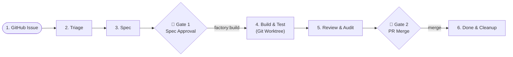

# Team Onboarding & Getting Started with `acp-factory`

Welcome to `acp-factory`! This guide walks you through setting up your environment, understanding how the factory works, and using it day-to-day to take GitHub issues from idea to reviewed Pull Request.

---

## 1. What is `acp-factory`?

`acp-factory` is a local, multi-stage software engineering runner. It uses the **Agent Client Protocol (ACP)** to coordinate coding agents (`opencode`, `agy`, `copilot`, `kiro`, etc.) through a structured, predictable 5-stage GitHub lifecycle:



### Key Principles for the Team
- **Two Mandatory Human Gates**: Agents **never** write code until you approve the spec (Gate 1), and **never** merge a Pull Request (Gate 2).
- **Isolated Worktrees**: All coding and testing happens in isolated git worktrees (`.worktrees/issue-<id>`). Your current working tree and `main` branch are never polluted.
- **Zero Comment Spam**: Agents update the issue specification directly in-place inside the Issue Body. Issue comments are strictly reserved for human feedback.
- **Self-Healing Verification**: Before code can move to review, deterministic test and lint checks (`just fix`, `just typecheck`, `just test-fast`) must pass locally inside the worktree.

---

## 2. One-Time Setup (5–10 Minutes)

### Step 1: Install Dependencies
Ensure you have the following installed on your machine:
- **Python 3.14+**
- **[`uv`](https://docs.astral.sh/uv/)**: Fast Python package and tool manager.
- **[`gh` (GitHub CLI)](https://cli.github.com/)**: Authenticated with your team repository permissions:
  ```bash
  gh auth status
  # If not logged in:
  gh auth login
  ```

### Step 2: Install `acp-factory`
Install `acp-factory` as a global CLI tool using `uv`:

```bash
# Direct install from repository
uv tool install git+https://github.com/stephanie-w/acp-factory.git

# Or if you are developing locally inside the cloned repository:
uv tool install -e .
```

Verify your installation:
```bash
acp-factory --help
```

### Step 3: Configure Agent Registry (`~/.acpterm/config.json`)
`acp-factory` connects to agents via `acpterm`. Ensure your desired agent CLI (e.g. `opencode` or `agy`) is installed and registered in your `~/.acpterm/config.json`:

```json
{
  "default_agent": "opencode",
  "agents": {
    "opencode": {
      "command": "opencode",
      "args": ["acp"]
    },
    "agy": {
      "command": "agy",
      "args": ["acp"]
    }
  }
}
```

### Step 4: Clone the Shared Prompts & Skills Catalog
`acp-factory` personas, prompts, and skills are maintained in the shared resources repository:

```bash
git clone https://github.com/stephanie-w/coding-ai-resources.git ~/DEV/coding-ai-resources
```

Add this environment variable to your shell configuration (`~/.bashrc`, `~/.zshrc`):
```bash
export FACTORY_RESOURCES_DIR="$HOME/DEV/coding-ai-resources"
```
*(Alternatively, `.factory/config.toml` in your repository can point to `resources_dir = "~/DEV/coding-ai-resources"`).*

---

## 3. Daily Workflow: Working with the Factory

### Step 1: Create a GitHub Issue
Create a normal GitHub issue describing the bug, feature, or task. To enter the factory pipeline, add the `factory:triage` label:

```bash
gh issue create --title "feat(api): add healthcheck endpoint" --label "factory:triage" --body "Please add a /healthz endpoint returning 200 OK and JSON status."
```

### Step 2: Run Triage & Specification
You can process the issue explicitly:

```bash
# Preview what the agent would do without making any GitHub mutations:
acp-factory issue <id> --stage triage --dry-run

# Run triage (sizes task, checks if duplicate or too big):
acp-factory issue <id> --stage triage

# Run spec generation:
acp-factory issue <id> --stage spec
```

Once `spec` finishes, the orchestrator updates the issue body with:
- Problem breakdown & proposed architecture.
- Mermaid diagrams of data/control flow.
- Acceptance criteria table (AC-1, AC-2, etc.).
- The label is automatically transitioned to `factory:spec-ready`.

---

### 🛑 Human Gate 1: Spec Approval
**This is where human engineering judgment happens.**
1. Open the issue on GitHub.
2. Read the generated specification in the issue description.
3. **If approved**: Change the label from `factory:spec-ready` to `factory:build`.
4. **If adjustments needed**: Leave a comment with feedback or edit the issue body directly, and set the label to `factory:spec` to re-run.

---

### Step 3: Run the Build Stage
Once labeled `factory:build`, execute the implementation:

```bash
acp-factory issue <id> --stage build
```

What happens under the hood:
1. `acp-factory` creates/reuses an isolated worktree at `.worktrees/issue-<id>` on branch `factory/issue-<id>`.
2. The implementer agent writes code and tests.
3. Configured checks run (e.g. `just fix`, `just typecheck`, `just test-fast`).
4. If checks fail, the agent self-heals in a feedback loop (up to `max_attempts`).
5. On pass, changes are committed locally and labeled `factory:review`.

---

### Step 4: Run the Review Stage
Run the automated review:

```bash
acp-factory issue <id> --stage review
```

1. An independent reviewer agent audits the git diff against the spec and runs a security audit.
2. If accepted:
   - The branch is pushed to `origin`.
   - A Pull Request is opened or updated on GitHub referencing the issue.
   - The issue label is transitioned to `factory:pr-ready`.
3. If changes requested:
   - The label returns to `factory:build` with review findings embedded in the issue body for the next build attempt.

---

### 🛑 Human Gate 2: PR Review & Merge
1. Open the created Pull Request on GitHub.
2. Review the code diff, CI checks, and the automated review audit.
3. Merge the PR when ready.
4. Run `done` cleanup:
   ```bash
   acp-factory issue <id> --stage done
   ```
   This deletes the local worktree (`.worktrees/issue-<id>`) and marks the issue `factory:completed`.

---

## 4. Helpful CLI Commands Cheat Sheet

| Task | Command |
| :--- | :--- |
| **View pipeline status** | `acp-factory status` |
| **Run next pending task automatically** | `acp-factory next` |
| **Run a specific issue through its current stage** | `acp-factory issue <id>` |
| **Force a specific stage** | `acp-factory issue <id> --stage <triage\|spec\|build\|review\|done>` |
| **Preview without mutating GitHub or git** | `acp-factory issue <id> --dry-run` |
| **Review any local branch against main** | `acp-factory review` |
| **Inspect past run logs & transcripts** | Check `.factory/runs/<run-id>/` |

---

## 5. Team Safety & FAQ

> [!IMPORTANT]
> **Can agents push directly to `main`?**  
> **No.** All building happens on dedicated branches (`factory/issue-<id>`) inside isolated worktrees. Only humans can merge to `main`.

> [!NOTE]
> **What should I do if an issue gets labeled `factory:needs-human`?**  
> This happens when triage flags an issue as `TOO_BIG` or duplicate, when spec questions require developer input, or if build retries are exhausted. Check the issue body for `## Open Questions` or failure reasons, leave a comment with guidance, and reset the label to `factory:spec` or `factory:build`.

> [!TIP]
> **Always start with `--dry-run`**  
> If you are experimenting with a new issue or configuration, pass `--dry-run`. It executes the agent in a read-only pass and prints the exact GitHub CLI commands and diffs that would be run.
