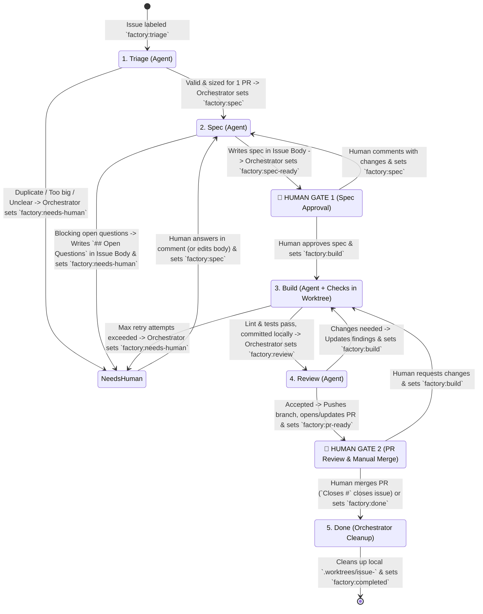

# `acp-factory` Workflow & Core Concepts

`acp-factory` is an automated software engineering orchestrator built on the **Agent Client Protocol (ACP)** via [`acpterm`](/home/stephanie/DEV/acpterm) and **APM (Agent Package Manager)**.

Inspired by `owainlewis/factory` and `owainlewis/software-factory`, it turns a GitHub Issue into a verified specification, builds and tests it in an isolated git worktree, reviews the branch with an independent reviewer persona, and delivers a reviewed Pull Request for a human to merge.

---

## 1. Core Concepts

### A. What is a Task?
In `acp-factory`, a **Task** (`TaskContext`) is a stateful work item backed by a **GitHub Issue** (or an ad-hoc CLI prompt for local one-off runs):
- **Identity**: GitHub Issue number (`#42`), title, and original description.
- **Living Specification**: Stored in-place inside the **GitHub Issue Body** between `<!-- factory:start -->` and `<!-- factory:end -->` markers.
- **Human Feedback**: Stored in **GitHub Issue Comments** (written strictly by humans).
- **Stage State**: Controlled by `factory:*` **GitHub Labels** on the issue.
- **Workspace**: An issue-dedicated git worktree (`.worktrees/issue-42` on branch `factory/issue-42`) that persists across `build` and `review` rounds until the `done` stage.

---

### B. Who Writes Where on GitHub (Zero Bot Comment Spam)

To keep issues clean and readable, `acp-factory` enforces a strict separation between the Issue Body and Issue Comments:

| GitHub Surface | Written By | Purpose |
| :--- | :--- | :--- |
| **Issue Body (Top)** | **Human** (or issue creator) | Original problem statement. Never overwritten. |
| **Issue Body (`<!-- factory:start -->` block)** | **Orchestrator** (and **Human** if editing directly) | Single canonical source of truth for Triage status, the Specification, `## Assumptions`, `## Decisions`, and any `## Open Questions`. Updated in-place via `gh issue edit`. |
| **Issue Comments** | **Human Only** | Human answers to open questions, review feedback, or revision requests. The orchestrator **never** posts bot comments on the issue thread. |
| **Issue Labels (`factory:*`)** | **Orchestrator** (on stage pass/halt) & **Human** (at Gates 1 & 2) | Drives the 5-stage workflow state machine. Agents cannot mutate labels directly. |
| **Pull Request** | **Orchestrator** (opens/updates PR after `review` passes) | Delivers the reviewed branch and PR description for **Human Gate 2**. Never auto-merged. |

---

## 2. The 5-Stage GitHub Label State Machine

### Stage Reference

1. **`triage` (`factory:triage`)**:
   - **Mode**: Read-only (`read_only = true`, `mode = "plan"`).
   - **Action**: Inspects the codebase and existing issues to check for duplicates and verify the ticket fits a single reviewable PR.
   - **Transition**: Updates the `<!-- factory:start -->` block in the Issue Body and transitions to `factory:spec` (or `factory:needs-human` if `duplicate` / `too_big`).

2. **`spec` (`factory:spec`)**:
   - **Mode**: Read-only (`read_only = true`, `mode = "plan"`).
   - **Action**: Reads the Issue Body + all human comments, analyzes the codebase, and writes the specification into the Issue Body (`## Behavior`, `## Files to Touch`, `## Assumptions`, `## Decisions`, `## Out of Scope`, `## Acceptance Criteria`).
   - **Handling Ambiguities (Two-Tier Rule)**:
     - **Reversible choices**: Recorded under `## Assumptions`; transitions to `factory:spec-ready` (**Human Gate 1**).
     - **Blocking questions**: Recorded under `## Open Questions` with recommended options in the Issue Body; transitions to `factory:needs-human`. Once the human answers in a comment and flips the label back to `factory:spec`, the next run folds those answers into `## Decisions` and clears `## Open Questions`.

3. **`build` (`factory:build`)**:
   - **Mode**: Read/Write inside isolated git worktree `.worktrees/issue-<id>` on branch `factory/issue-<id>`.
   - **Pre-Setup**: Runs configured `pre` commands (`apm install --frozen`, `uv sync`) once in the worktree.
   - **Action**: Implements the spec with unit/integration tests and runs sequential verification checks (`lint`, `test`) in a self-healing retry loop (up to `max_attempts`). Commits locally without pushing.
   - **Transition**: Sets `factory:review` on pass, or `factory:needs-human` if retries are exhausted.

4. **`review` (`factory:review`)**:
   - **Mode**: Read-only (`read_only = true`), using a skeptical Reviewer persona and `llm_judge` skill (optionally with a distinct model or agent for cross-model verification).
   - **Action**: Reviews the local branch diff, commit messages, and test coverage against the spec in the Issue Body.
   - **Transition**:
     - If **accepted**: Orchestrator pushes `factory/issue-<id>`, opens/updates the GitHub Pull Request (`Closes #<id>`), and sets `factory:pr-ready` (**Human Gate 2**).
     - If **revision needed**: Updates review findings in the Issue Body and sets `factory:build` for another build round (up to 3 review rounds).

5. **`done` (`factory:done` or Issue `CLOSED`)**:
   - **Mode**: Orchestrator cleanup (no automatic PR merging).
   - **Action**: Triggered automatically when the GitHub Issue is `CLOSED` (e.g. when the human merges the PR containing `Closes #<id>` at **Human Gate 2**) or when `factory:done` is set. The orchestrator removes the local `.worktrees/issue-<id>` worktree and local branch, removes prior stage labels, and sets `factory:completed`.

---

## 3. Per-Stage Agent Customization (`acpterm` + `apm`)

Each stage in `.factory/config.toml` can customize its ACP agent independently:

- **`agent` & `model`**: Select any agent configured in `~/.acpterm/config.json` (`opencode`, `kiro`, `agy`) and override its model per stage.
- **`mode` & `read_only`**: Enforce `read_only = true` and `mode = "plan"` on `triage`, `spec`, and `review`.
- **`persona`**: Prepend a role-specific Markdown persona (`.factory/personas/{triage,architect,implementer,reviewer}.md`).
- **`skills`**: Attach stage-specific `SKILL.md` files (from `.factory/skills/`, `skills/`, or `apm_modules/` managed via `apm install`) as ACP `resources`.

---

## 4. Safe Iteration with `--dry-run` & Read-Only Agent `gh` Guardrail

While tuning personas, stage prompts, and `apm` skills, you can run in **Dry-Run Mode** (`--dry-run` on the CLI or `dry_run = true` in `.factory/config.toml`):

1. **Read-Only Agent `gh` Shim (Always Active)**:
   - Worker and reviewer agents are spawned with a `gh` PATH shim that allows read subcommands (`gh issue view`, `gh issue list`, `gh pr view`, `gh search`) and **blocks all mutating `gh` subcommands** (`edit`, `create`, `comment`, `close`, `merge`).
2. **Human-Only GitHub Writes (`--dry-run`)**:
   - `acp-factory issue 42 --dry-run` fetches Issue `#42` and runs the full ACP stage live in your terminal.
   - Instead of mutating GitHub, it saves the proposed Issue Body to `.factory/runs/<run-id>/issue-42-body.md` (and PR body if applicable) and prints a **Manual GitHub Commands** panel with the exact `gh issue edit` / `gh pr create` commands for you to execute manually.
