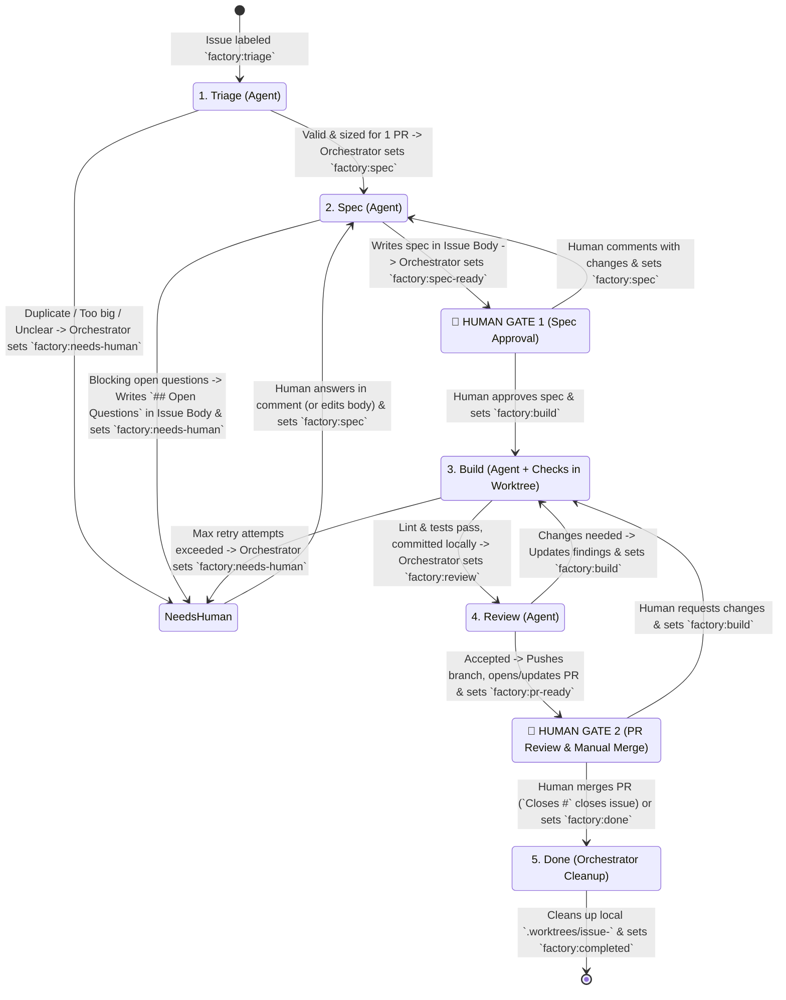

# `acp-factory` Workflow & Core Concepts

`acp-factory` is an automated software engineering orchestrator built on the **Agent Client Protocol (ACP)** via [`acpterm`](/home/stephanie/DEV/acpterm) and **APM (Agent Package Manager)**.

Inspired by `owainlewis/factory` and `owainlewis/software-factory`, it turns a GitHub Issue into a verified specification, builds and tests it in an isolated git worktree, reviews the branch with an independent reviewer persona, and delivers a reviewed Pull Request for a human to merge.

---

## 1. Core Concepts

### A. What is a Task?
In `acp-factory`, a **Task** (`TaskContext`) is a stateful work item backed by a **GitHub Issue** (or an ad-hoc CLI prompt for local one-off runs):
- **Identity**: GitHub Issue number (`#42`), title, and original description.
- **Living Specification**: Stored in-place inside the **GitHub Issue Body** between `<!-- factory:start -->` and `<!-- factory:end -->` markers.
- **Human Feedback**: Stored in **GitHub Issue Comments** (written strictly by humans).
- **Stage State**: Controlled by `factory:*` **GitHub Labels** on the issue.
- **Workspace**: An issue-dedicated git worktree (`.worktrees/issue-42` on branch `factory/issue-42`) that persists across `build` and `review` rounds until the `done` stage.

---

### B. Who Writes Where on GitHub (Zero Bot Comment Spam)

To keep issues clean and readable, `acp-factory` enforces a strict separation between the Issue Body and Issue Comments:

| GitHub Surface | Written By | Purpose |
| :--- | :--- | :--- |
| **Issue Body (Top)** | **Human** (or issue creator) | Original problem statement. Never overwritten. |
| **Issue Body (`<!-- factory:start -->` block)** | **Orchestrator** (and **Human** if editing directly) | Single canonical source of truth for Triage status, the Specification, `## Assumptions`, `## Decisions`, and any `## Open Questions`. Updated in-place via `gh issue edit`. |
| **Issue Comments** | **Human Only** | Human answers to open questions, review feedback, or revision requests. The orchestrator **never** posts bot comments on the issue thread. |
| **Issue Labels (`factory:*`)** | **Orchestrator** (on stage pass/halt) & **Human** (at Gates 1 & 2) | Drives the 5-stage workflow state machine. Agents cannot mutate labels directly. |
| **Pull Request** | **Orchestrator** (opens/updates PR after `review` passes) | Delivers the reviewed branch and PR description for **Human Gate 2**. Never auto-merged. |

---

## 2. The 5-Stage GitHub Label State Machine

> 💡 See **[docs/github-project-setup.md](github-project-setup.md)** for tracking options, including direct **[GitHub Global Search Filters](github-project-setup.md#1-zero-setup-github-global-search-filters-recommended)** for your browser bookmarks and optional GitHub Projects (v2) boards.



> **Fail-fast guard:** If a stage run's agent produces no output (the session aborts or fails before emitting any messages), the run fails immediately and the Issue transitions to `factory:needs-human` instead of advancing.

### Stage Reference

1. **`triage` (`factory:triage`)**:
   - **Mode**: Read-only (`read_only = true`, `mode = "plan"`).
   - **Action**: Inspects the codebase and existing issues to check for duplicates and verify the ticket fits a single reviewable PR.
   - **Transition**: Updates the `<!-- factory:start -->` block in the Issue Body and transitions to `factory:spec` (or `factory:needs-human` if `duplicate` / `too_big`).

2. **`spec` (`factory:spec`)**:
   - **Mode**: Read-only (`read_only = true`, `mode = "plan"`).
   - **Action**: Reads the Issue Body + all human comments, analyzes the codebase, and writes the specification into the Issue Body (`## Behavior`, `## Files to Touch`, `## Assumptions`, `## Decisions`, `## Out of Scope`, `## Acceptance Criteria`).
   - **Handling Ambiguities (Two-Tier Rule)**:
     - **Reversible choices**: Recorded under `## Assumptions`; transitions to `factory:spec-ready` (**Human Gate 1**).
     - **Blocking questions**: Recorded under `## Open Questions` with recommended options in the Issue Body; transitions to `factory:needs-human`. Once the human answers in a comment and flips the label back to `factory:spec`, the next run folds those answers into `## Decisions` and clears `## Open Questions`.

3. **`build` (`factory:build`)**:
   - **Mode**: Read/Write inside isolated git worktree `.worktrees/issue-<id>` on branch `factory/issue-<id>`.
   - **Pre-Setup**: Runs configured `pre` commands (`apm install --frozen`, `uv sync`) once in the worktree.
   - **Action**: Implements the spec with unit/integration tests and runs sequential verification checks (`lint`, `test`) in a self-healing retry loop (up to `max_attempts`). Commits locally without pushing.
   - **Transition**: Sets `factory:review` on pass, or `factory:needs-human` if retries are exhausted.

4. **`review` (`factory:review`)**:
   - **Mode**: Read-only (`read_only = true`), using a skeptical Reviewer persona and `llm_judge` skill (optionally with a distinct model or agent for cross-model verification).
   - **Action**: Reviews the local branch diff, commit messages, and test coverage against the spec in the Issue Body.
   - **Transition**:
     - If **accepted**: Orchestrator pushes `factory/issue-<id>`, opens/updates the GitHub Pull Request (`Closes #<id>`), and sets `factory:pr-ready` (**Human Gate 2**).
     - If **revision needed**: Updates review findings in the Issue Body and sets `factory:build` for another build round (up to 3 review rounds).

5. **`done` (`factory:done` or Issue `CLOSED`)**:
   - **Mode**: Orchestrator cleanup (no automatic PR merging).
   - **Action**: Triggered automatically when the GitHub Issue is `CLOSED` (e.g. when the human merges the PR containing `Closes #<id>` at **Human Gate 2**) or when `factory:done` is set. The orchestrator removes the local `.worktrees/issue-<id>` worktree and local branch, removes prior stage labels, and sets `factory:completed`.

---

## 3. Per-Stage Agent Customization, Domain-Agnostic Core & `apm` Skills

> 📖 **See [docs/model-selection.md](model-selection.md) for stage-by-stage model recommendations, reasoning strategies, and cross-model verification setups.**

### A. Domain-Agnostic Factory Core vs. Pluggable Domain Skills
`acp-factory` separates **universal factory governance** from **domain/tech-stack specifics**:

1. **Universal Factory Core (`.factory/personas/`, `.factory/prompts/`, and bundled `skills/`)**:
   - **Triage (`issue-triage`)**: Fact-checks claims against the repository, distinguishes `DUPLICATE` vs. `ALSO_FIXES`, and enforces single-PR sizing (**< ~400 changed lines** in one cohesive area) or outputs a build-order `### Suggested Split` (`STATUS: TOO_BIG`).
   - **Specification (`spec-writer`)**: Produces a falsifiable `## Acceptance Criteria` table (`| ID | Done when | How to check |` using `AC-1`, `AC-2`, ...) and applies the **cost-to-undo + dependency/compute/IAM filter** to decide between `## Assumptions` (`STATUS: SPEC_READY`) and `## Open Questions` (`STATUS: NEEDS_HUMAN` with 2-3 options + recommendation).
   - **Builder (`tdd-builder`)**: Turns each `AC-n` row into an executable local check/test first, implements minimal root-cause changes within `## Files to Touch`, probes bad/borderline inputs (including `NaN`/`Inf`/`null`/batch boundaries), and follows the 7-point quality standard.
   - **Reviewer (`code-reviewer` & `security-auditor`)**: Skeptically verifies `git diff` against every `AC-n` row, checks test effectiveness (revert-test heuristic: would existing tests fail if the fix were broken?), traces untrusted input from source to sink with concrete exploit/trigger proof, classifies risk (`LOW` / `MEDIUM` / `HIGH` with path elevation rules), and grades findings (`blocking`, `major`, `minor`).

2. **Adapting `AC-n` ("How to check") Across Software, MLOps & Cloud IaC**:
   - Because agents run inside isolated local git worktrees without live production cloud credentials or GPU clusters, `How to check` in `AC-n` is generalized by domain:
     - **Python / Application / ML Serving Endpoints**: `pytest` unit/contract tests using lightweight model stubs/fixtures and borderline payload checks (`NaN`, `Inf`, empty/oversized batches).
     - **ML & Data Pipelines (Kubeflow, Vertex, Airflow, Argo, CI)**: Offline DAG/workflow compilation and artifact schema dry-run checks.
     - **Cloud IaC & Containers (Terraform/OpenTofu, Helm, K8s, Docker)**: Static and plan-time local validation (`terraform fmt -check && terraform validate`, `tflint`, `helm template`, `kubeconform`) — **never** live cloud mutations.

3. **Workspace & Catalog Skills via `apm` (`~/DEV/coding-ai-resources`)**:
   - Target workspaces bring their own `apm.yml` and run `apm install` as a `pre` / `setup` command in `.factory/config.toml` (deploying project skills into `.agents/skills/` or `apm_modules/`).
   - `resolve_skill_paths` searches the target workspace first (`.factory/skills/`, `skills/`, `.agents/skills/`, `.apm/skills/`, `apm_modules/`) and falls back to `acp-factory`'s bundled `skills/` directory so built-in skills work out-of-the-box on any repository.

---

## 4. Standalone Branch Review & Pull Request Creation (`acp-factory review`)

When you have an existing working branch in a repository without a GitHub Issue, you can run the standalone `review` command:

```bash
# Review current branch in read-only mode and preview PR creation:
acp-factory review "Short claim/description of what the branch does" \
  --workspace /path/to/repo \
  --create-pr \
  --dry-run

# If REVISION_NEEDED, run a fresh builder revision round on the branch:
acp-factory run \
  "Revision round: Read .factory/runs/<run-id>/pr-<branch>-body.md, fix [blocking]/[major] findings, and commit." \
  --stage build \
  --skill tdd-builder \
  --workspace /path/to/repo
```

---

## 5. Safe Iteration with `--dry-run` & Read-Only Agent `gh` Guardrail

While tuning personas, stage prompts, and `apm` skills, you can run in **Dry-Run Mode** (`--dry-run` on the CLI or `dry_run = true` in `.factory/config.toml`):

1. **Read-Only Agent `gh` Shim (Always Active)**:
   - Worker and reviewer agents are spawned with a `gh` PATH shim that allows read subcommands (`gh issue view`, `gh issue list`, `gh pr view`, `gh search`) and **blocks all mutating `gh` subcommands** (`edit`, `create`, `comment`, `close`, `merge`).
2. **Human-Only GitHub Writes (`--dry-run`)**:
   - `acp-factory issue 42 --dry-run` fetches Issue `#42` and runs the full ACP stage live in your terminal.
   - Instead of mutating GitHub, it saves the proposed Issue Body to `.factory/runs/<run-id>/issue-42-body.md` (and PR body if applicable) and prints a **Manual GitHub Commands** panel with the exact `gh issue edit` / `gh pr create` commands for you to execute manually.

---

## 6. Engineering Retrospectives (`retro`)

Retrospectives close the continuous improvement loop by having an architect agent analyze completed runs, multi-attempt failures, and check logs to propose concrete improvements to the agent environment (`AGENTS.md`, `.factory/config.toml`, automated checks, and prompts).

### A. How to Run a Retrospective

You can trigger a retrospective directly via the CLI:

```bash
# Run retro against recent .factory/runs/ in the current workspace:
acp-factory run --stage retro

# Target a specific workspace:
acp-factory run --stage retro --workspace /path/to/repo

# Run an ad-hoc retrospective focusing on a specific run ID:
acp-factory run \
  "Execute retro against run .factory/runs/20261112-120000-abc123 and AGENTS.md" \
  --stage retro
```

### B. Structured Run Artifacts & Fast Querying with `jq`

Each execution stores structured artifacts under `.factory/runs/<run-id>/`:
- **`run.json`**: Top-level run metadata (attempts used, total duration, budget token/cost consumption, stage outcome, and failure reason).
- **`attempt-<N>/transcript.summary.json`**: Condensed event snapshot with truncated tool output previews and omitted raw scratchpads. Tailored for token efficiency during `retro`.
- **`attempt-<N>/transcript.json`**: Complete structured JSON event tree containing all tool invocations, inputs, file operations, permissions, and duration.
- **`attempt-<N>/transcript.md`**: Full raw Markdown transcript for human deep dives.
- **`attempt-<N>/check-<N>-<slug>.log`**: Raw stdout/stderr execution output from verification checks.

You can easily query and analyze transcripts using `jq`:

```bash
# Quick attempt summary (duration, stop reason, tool count, tokens):
jq '.summary' .factory/runs/<run-id>/attempt-1/transcript.summary.json

# List all tool calls with status and title:
jq '.tool_calls[] | {title: .title, status: .status}' .factory/runs/<run-id>/attempt-1/transcript.json

# Find failed tool calls:
jq '.tool_calls[] | select(.status != "completed")' .factory/runs/<run-id>/attempt-1/transcript.json

# Calculate tool frequencies (tool economy):
jq '.tool_calls | group_by(.title) | map({tool: .[0].title, count: length})' .factory/runs/<run-id>/attempt-1/transcript.json

# List unique files touched during the turn:
jq '.file_operations | map(.path) | unique' .factory/runs/<run-id>/attempt-1/transcript.summary.json
```

### C. The 7 Retrospective Categories

The `retro` agent evaluates session evidence across 7 specific areas:
1. **Navigation**: Did the agent waste turns hunting for files or entrypoints? (*Fix*: Add a 1–2 line pointer in `AGENTS.md`).
2. **Automated Checks (Highest Leverage)**: Can a recurring error be caught by a deterministic check (`just`, linter rule, or validator) rather than a prose rule?
3. **Coding Standards & Reviewer Rubric**: Did the reviewer catch genuine bugs, or did it flag noisy subjective patterns?
4. **`AGENTS.md` Diet**: Are there bloated task-specific instructions in steering files that should be trimmed or moved to checks?
5. **Tool Economy**: Were expensive tools or un-truncated commands run repeatedly?
6. **No-ops**: Are there instructions that agents consistently ignore?
7. **Information Access**: Was the agent blocked by missing local environment context or documentation?

Output is formatted as a ranked Markdown report (`HIGH`, `MEDIUM`, `LOW`) with concrete unified diff proposals for human review.
